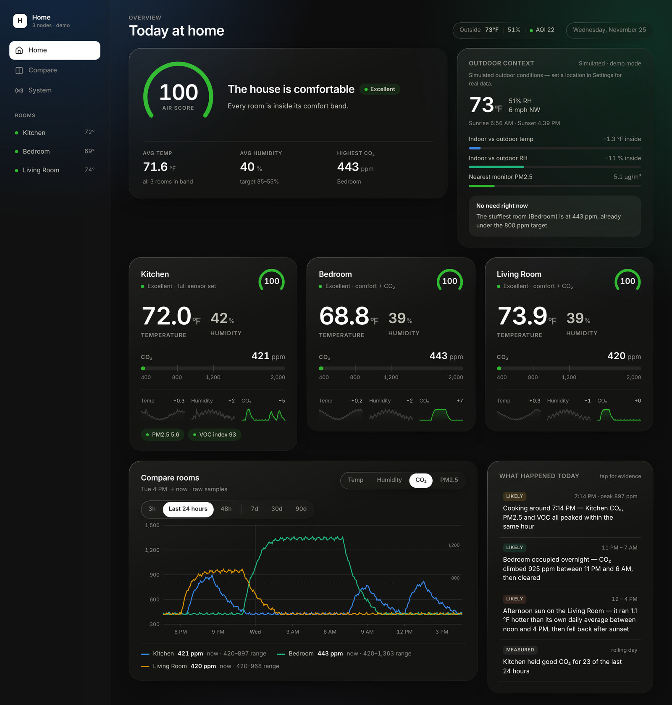
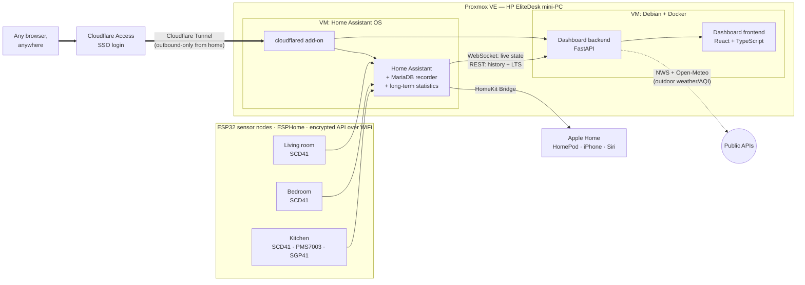
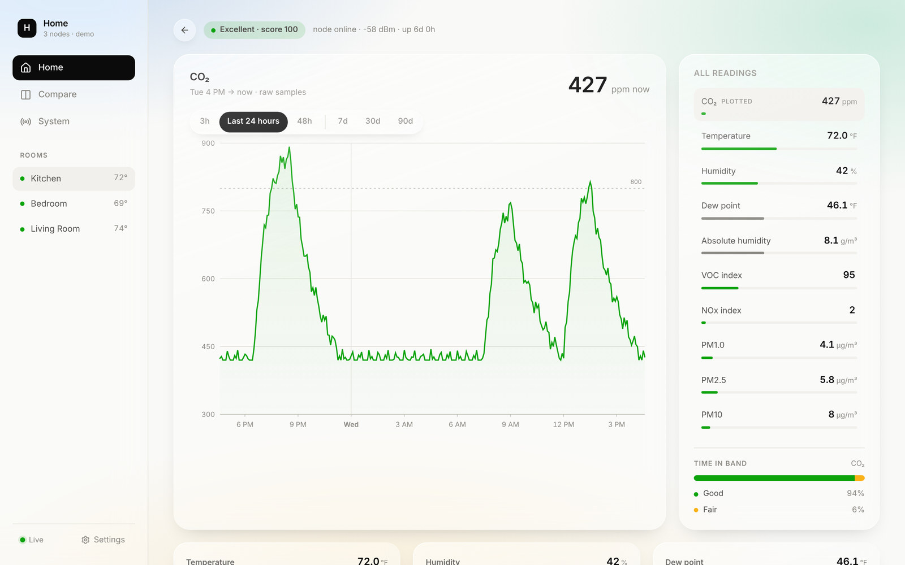
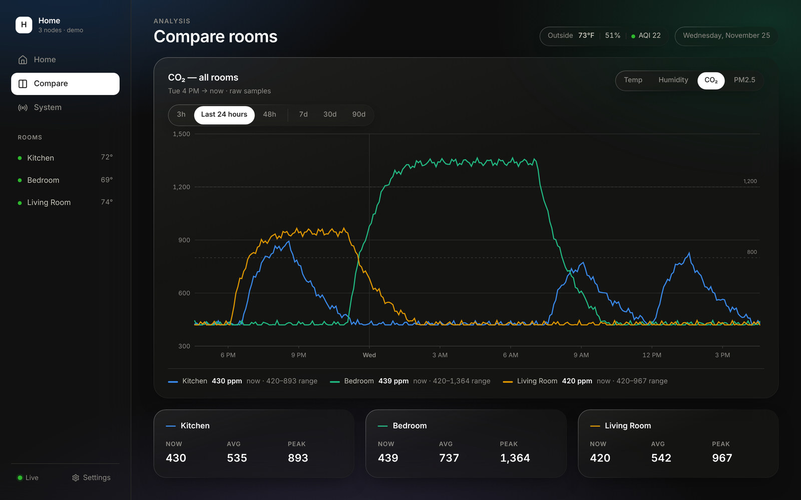
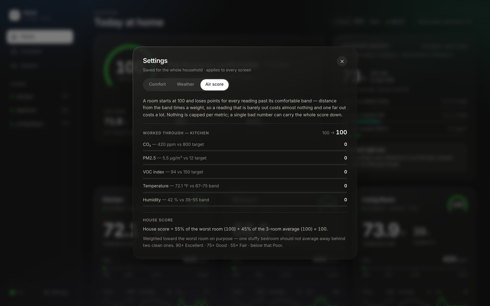
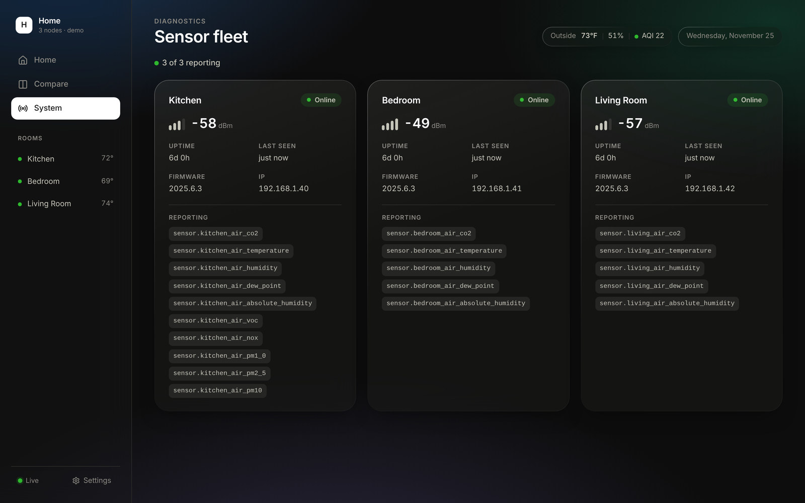
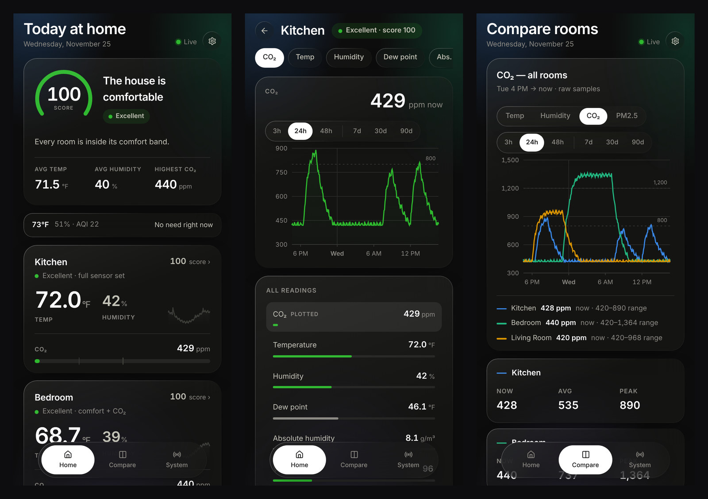
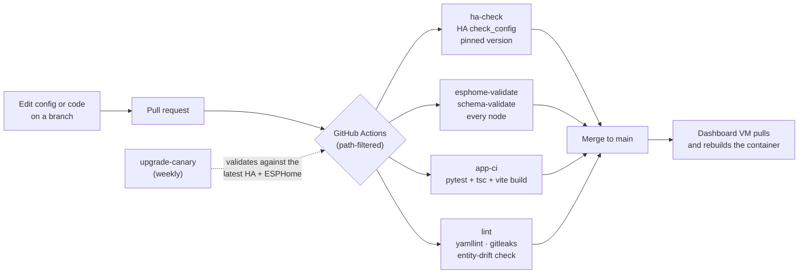

# Home-Hub

**A self-hosted, local-first smart home built from the ground up — custom ESP32
air-quality sensors, a virtualized Home Assistant server, and a full-stack
dashboard app, all managed as code in this one repository.**

[](https://github.com/alaurin10/Home-Hub/actions/workflows/app-ci.yml)
[](https://github.com/alaurin10/Home-Hub/actions/workflows/ha-check.yml)
[](https://github.com/alaurin10/Home-Hub/actions/workflows/esphome-validate.yml)
[](https://github.com/alaurin10/Home-Hub/actions/workflows/lint.yml)




<sub>Screenshots are from the app's built-in demo mode, which runs a simulator in place of the live sensors.</sub>

---

## At a glance

| | |
|---|---|
| **What it is** | A home-lab project: three hand-wired sensor nodes report CO₂, temperature, humidity, particulates and VOCs into Home Assistant. A custom web app turns that data into an at-a-glance "air score", history charts and plain-English insights. |
| **Status** | **Live.** It runs 24/7 on a Proxmox mini-PC, and I can reach it from any browser through a zero-trust tunnel. |
| **My role** | Sole designer and developer: hardware selection and wiring, firmware config, server and network setup, backend, frontend, CI/CD and documentation. |
| **Stack** | ESP32 + ESPHome · Home Assistant OS · Proxmox VE · Python / FastAPI · React / TypeScript / Vite / Tailwind · Docker · GitHub Actions · Cloudflare Tunnel |
| **Scale** | 3 sensor nodes · 10 sensor types · 2 Proxmox VMs · 6 CI workflows · 119 backend tests · 85+ commits across 28 PRs |

## Highlights

- **Custom hardware, end to end.** I picked the sensors (Sensirion SCD41 for
  true NDIR CO₂, Plantower PMS7003 for PM1/2.5/10, Sensirion SGP41 for VOC/NOx),
  wired them to ESP32 boards, and configure the firmware declaratively. All
  three nodes share one DRY ESPHome base config.
- **A full-stack dashboard app.** The FastAPI backend proxies Home Assistant's
  WebSocket and REST APIs. The React + TypeScript frontend gets live updates over
  a WebSocket, shows charts from 3 hours to 90 days, and has a responsive
  desktop/mobile layout.
- **Data products, not just charts.** It computes a **0–100 air score** per room
  and for the house, gets **outdoor context** from public weather and AQI APIs,
  and runs a **rule-based insight engine** that spots cooking, overnight
  occupancy, solar gain and when it's worth ventilating. Every insight shows the
  evidence behind it.
- **Infrastructure as code.** The git root *is* Home Assistant's `/config`. Every
  sensor, automation and dashboard is version-controlled, reviewed in a PR and
  validated by CI before it reaches the house.
- **Secure remote access with zero open ports.** The dashboards are reachable
  from any browser through an outbound-only Cloudflare Tunnel behind
  Cloudflare Access SSO. The router has no inbound ports and no VPN client is
  needed.
- **Production habits on a personal project.** Pinned versions, a weekly
  upgrade canary, secret scanning, an entity-drift checker, recovery runbooks
  and a written architecture decision log.

---

## System architecture



Two surfaces are kept separate on purpose. **Apple Home** handles everyday
control and Siri. **The custom dashboard** handles deep history and analysis.
Automations live in Home Assistant, so a cloud outage never affects how the
house behaves.

---

## The dashboard app

`apps/dashboard/` is a **FastAPI** backend serving a **React 18 + TypeScript**
frontend (Vite, Tailwind CSS 4, Framer Motion, Recharts, Zustand). It runs as a
Docker Compose stack on the Proxmox Docker VM and redeploys itself when
`main` changes.

### Room detail: history from 3 hours to 90 days



Up to 48 hours, the backend returns raw samples from Home Assistant's history
API. For 7, 30 and 90 days it switches to HA's hourly **long-term statistics**
(mean/min/max), so there's no separate time-series database to run.

### Compare rooms side by side



### An explainable air score



Each room starts at 100 and loses points for each reading outside its comfort
band, scaled by distance and a per-metric weight. The house score is weighted
toward the worst room, so one stuffy bedroom isn't hidden behind two clean
rooms. The score is computed server-side, so every client agrees. The UI shows
the arithmetic straight from the API, so the explanation can never drift from
the number.

### Sensor fleet health



### One build, desktop and phone



### What's under the hood

| Feature | How it works |
|---|---|
| **Live updates** | The backend holds one WebSocket subscription to Home Assistant and fans state changes out to browsers over `WS /api/stream`. |
| **Insight engine** | Plain rules (`insights.py`) over the last 24 hours. Causal guesses are labelled **Likely**, counted facts **Measured**, and each one carries its evidence. A rule that doesn't fire produces nothing. |
| **Outdoor context** | Geocodes a location, then reads the nearest **NWS** station (temperature, humidity, wind) and **Open-Meteo** (AQI, PM2.5). Sunrise and sunset are computed locally. No API keys. If the services are unreachable, the card is hidden rather than showing invented values. |
| **Config-driven UI** | Rooms, entities and thresholds live in `config.yaml`. Adding a room there adds a card with no frontend changes. |
| **Editable comfort bands** | Temperature and humidity bands can be tuned live from Settings and are saved server-side. Every status dot and score re-reads them. |
| **Demo mode** | A deterministic simulator generates realistic daily CO₂ curves, cooking spikes and comfort data, using the same Magnus formulas as the HA config. The app runs, and is tested, without any hardware. |
| **Auto-deploy** | A systemd timer on the Docker VM polls `origin/main` and rebuilds only when `apps/dashboard/**` changed. It's outbound-only: no webhook receiver and no inbound ports. |

---

## Hardware

| Node | Sensors | Measures |
|---|---|---|
| `esp-kitchen-air` | SCD41 + PMS7003 + SGP41 | CO₂, temperature, humidity, PM1.0/2.5/10, VOC index, NOx index |
| `esp-bedroom-air` | SCD41 | CO₂, temperature, humidity |
| `esp-living-air` | SCD41 | CO₂, temperature, humidity |

All three nodes are ESP32-WROOM-32 boards. Home Assistant derives **dew point**
and **absolute humidity** for every room in config (`packages/comfort.yaml`),
with no extra hardware. Each node also reports uptime, WiFi signal, firmware
version and IP for fleet monitoring. `safe_mode` means a bad firmware push can
always be re-flashed over the air.

**Server:** a reused HP EliteDesk 600 G3 Mini (i5-7500T, 16 GB RAM, 128 GB SSD)
running **Proxmox VE** with two VMs:

| Guest | Type | Resources | Runs |
|---|---|---|---|
| Home Assistant OS | VM | 2 vCPU · 4 GB · 48 GB | HA Core, ESPHome, MariaDB, cloudflared, Tailscale |
| Docker host | VM (Debian 12) | 2 vCPU · 4 GB · 24 GB | The dashboard app plus other personal compose stacks |

---

## Engineering practices

### Every change goes through CI



| Workflow | What it catches |
|---|---|
| `ha-check` | Invalid Home Assistant config, checked against the exact HA version running in the house (`.ha-version`). |
| `esphome-validate` | Broken device firmware configs, before they could be flashed. |
| `app-ci` | Backend regressions (119 pytest tests over the simulator, API, scoring, insights and weather parsing) and frontend type or build errors. |
| `lint` | YAML style problems, **secrets committed to tracked files** (gitleaks across the full history), and **entity drift**: a custom script that fails if any config references a sensor no device defines. |
| `upgrade-canary` | A weekly run against the *latest* HA and ESPHome releases, so a breaking upgrade shows up before I install it. |
| `deploy` | Staged OTA rollout to the sensor fleet through a self-hosted runner on the LAN. The pipeline is written but gated off until its hardening checklist is done. |

### Other habits

- **Secrets never touch git.** Real values live in gitignored `secrets.yaml` and
  `.env` files. CI validates against committed `*.example` templates.
- **Binding naming conventions.** `docs/01-naming-conventions.md` fixes entity
  IDs, hostnames and areas before any device is added, so renames never break
  history or Apple Home pairings.
- **Fleet health monitoring.** One template sensor lists any node whose data is
  more than 10 minutes old, and an automation raises an alert. Adding a node
  means adding one word to a list.
- **Recovery is documented and layered.** Git holds authored config, encrypted
  HA backups hold runtime state, and Proxmox snapshots allow host-level
  rollback (`docs/04` and `docs/05`).
- **Decisions are written down.** The architecture doc records each choice, the
  alternatives considered and why. An audit (`docs/08`) turned findings into
  tracked fixes.

### Selected design decisions

| Decision | Chosen | Why |
|---|---|---|
| Host platform | HA OS in a Proxmox VM | Keeps the supported HA appliance experience (add-ons, backups) while leaving room for other isolated services and VM snapshots |
| Device transport | ESPHome native API | Encrypted, auto-discovered, no MQTT broker needed for WiFi devices |
| Long-term data | HA long-term statistics | I started with InfluxDB + Grafana and **removed both**. LTS plus the app's own 7/30/90-day views cover the need with one less database to maintain. |
| Recorder DB | MariaDB | SQLite slows down as the device count grows. Choosing MariaDB up front avoids a later migration. |
| Remote access | Cloudflare Tunnel + Access (browser) and Tailscale (admin) | Reachable from any device with SSO and no inbound ports. Only the view is proxied; the data stays at home. |
| Dashboard auth | None in the app, by design | The HA token stays server-side. Access control is enforced at the Cloudflare edge, never by port-forwarding. |

---

## Status and roadmap

| Area | Status |
|---|---|
| Repo, naming conventions, CI gates | ✅ Done |
| Proxmox host + Home Assistant OS + MariaDB recorder | ✅ Live |
| ESP32 air-quality nodes (kitchen, bedroom, living room) | ✅ Live |
| Apple Home via HomeKit Bridge | ✅ Configured (allowlisted sensors) |
| Custom dashboard app (score, outdoor, insights) | ✅ Live, auto-deploys from `main` |
| Remote access via Cloudflare Tunnel + Access | ✅ Live |
| Zigbee lighting (Zigbee2MQTT + ZBT-2 coordinator) | 🔜 Planned |
| Automated push-to-deploy OTA for the sensor fleet | 🛠️ Pipeline written, hardening in progress |
| Infra monitoring outside HA (Uptime Kuma, dead-man's switch) | 🔜 Planned |

Further ideas in the backlog: mmWave presence sensing, closing the loop on air
quality (a smart plug runs the purifier when PM2.5 spikes), local voice control
and a wall-tablet kiosk view. See [`docs/09-roadmap.md`](docs/09-roadmap.md)
and §18 of the architecture doc.

---

## Try the dashboard locally

The app runs standalone in demo mode. No Home Assistant or hardware is needed.

```bash
cd apps/dashboard/backend
python3 -m venv .venv && .venv/bin/pip install -r requirements.txt
DEMO_MODE=1 .venv/bin/uvicorn app.main:app --port 8000
```

In a second terminal:

```bash
cd apps/dashboard/frontend && npm install && npm run dev
```

Open <http://localhost:5173>. Set `SIM_FAULT=bedroom` on the backend to see how
the UI handles an offline sensor. Full details, including running against a
real Home Assistant with Docker, are in
[`apps/dashboard/README.md`](apps/dashboard/README.md).

---

## Repository tour

| Path | What's there |
|---|---|
| [`apps/dashboard/`](apps/dashboard/) | The dashboard app: `backend/` (FastAPI, providers, scoring, insights, tests) and `frontend/` (React + TS) |
| [`esphome/`](esphome/) | Firmware config per sensor node; `common/` holds the shared base and sensor packages |
| [`packages/`](packages/) | Modular Home Assistant config: recorder, HomeKit, comfort metrics, monitoring, notifications |
| [`configuration.yaml`](configuration.yaml) | Thin HA entrypoint that loads `packages/` |
| [`.github/workflows/`](.github/workflows/) | CI gates, the upgrade canary and the deploy pipeline |
| [`scripts/`](scripts/) | Entity-drift checker and deploy helpers |
| [`proxmox/`](proxmox/) | Host notes: guest sizing, USB passthrough, snapshot policy |
| [`docs/`](docs/) | Architecture, runbooks, bill of materials, audit and roadmap |

## Documentation

| Doc | Covers |
|---|---|
| [`00-architecture.md`](docs/00-architecture.md) | The full design: decisions, alternatives considered, data layers, phased roadmap |
| [`01-naming-conventions.md`](docs/01-naming-conventions.md) | Binding naming rules and the device registry |
| [`02-bootstrap-proxmox-haos.md`](docs/02-bootstrap-proxmox-haos.md) | Step-by-step host build |
| [`03-bill-of-materials.md`](docs/03-bill-of-materials.md) | Parts, prices and sources for each phase |
| [`04-runbook-backups.md`](docs/04-runbook-backups.md) / [`05-runbook-recovery.md`](docs/05-runbook-recovery.md) | Backup and disaster-recovery procedures |
| [`06-verification.md`](docs/06-verification.md) | Definition-of-done checks for each phase |
| [`08-audit-2026-06.md`](docs/08-audit-2026-06.md) | Project audit: findings, fixes and backlog |
| [`09-roadmap.md`](docs/09-roadmap.md) | Infra roadmap: DNS, reverse proxy, monitoring |
| [`10-remote-access.md`](docs/10-remote-access.md) | Cloudflare Tunnel + Access setup runbook |

### Working on the live config

The repo root maps to Home Assistant's `/config`. To work on it, copy the secret
templates and fill them in locally (they're gitignored):

```bash
cp secrets.yaml.example secrets.yaml
```

```bash
cp esphome/secrets.yaml.example esphome/secrets.yaml
```

```bash
cp .env.example .env
```
